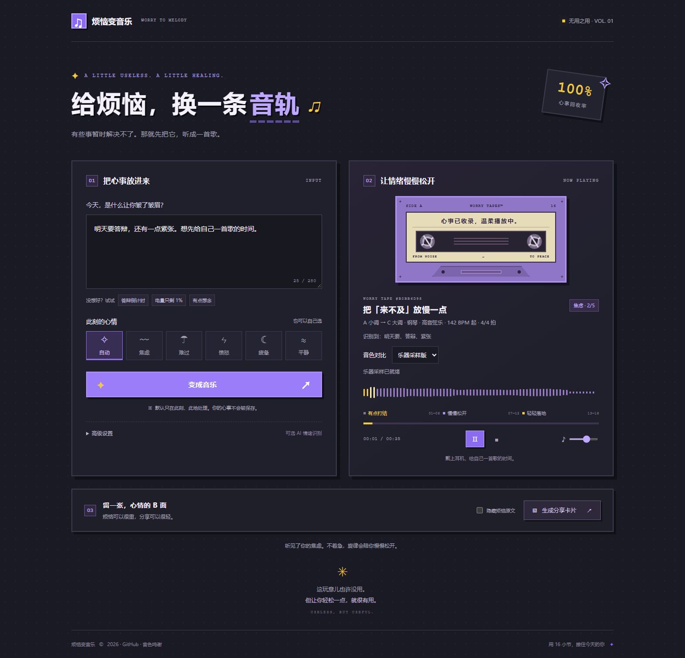

<div align="center">

# 烦恼变音乐
### WORRY TO MELODY

**给烦恼，换一条音轨。**

一句心事 · 16 小节 · 30 多秒的情绪旅程

[**▶ 在线体验**](https://chenxiyubp.github.io/worry-to-melody/) · [**下载体验包**](https://github.com/chenxiyubp/worry-to-melody/releases/latest) · [声音设计](docs/SOUND-DESIGN.md)


</div>



## 有些事暂时解决不了，那就先把它听成一首歌

「烦恼变音乐」是一件围绕 **“无用之用”** 创作的浏览器音乐小作品：写下一句烦恼，它会识别情绪，将文字映射为一段有起伏、有转折、有落点的旋律，再留下一张可以分享的心情卡片。

它没有待办清单，也不催你解决问题。它提供一个短暂的停顿：从有点打结，到慢慢松开，再轻轻落地。这里的“治愈”是创作表达，不是医疗效果承诺。

## 值得体验的六个细节

| 亮点 | 实现 |
|---|---|
| **心事有迹可循** | 五类情绪、分级词表、否定与转折处理；展示命中依据，支持手动选择。 |
| **音乐有叙事结构** | 16 小节采用 6 + 6 + 4 的三段结构，分层配器、乐句呼应与收束和声。 |
| **真实录音参与演奏** | 默认钢琴与大提琴采样，开放和弦、分解触键、种子控制的力度起伏与时间微扰。 |
| **每段旋律可以复现** | 同样的文字、情绪、强度与配置产生同一事件序列；AI 不生成音符。 |
| **为中断与失败做准备** | 加载进度、超时回退、后台暂停、重生成取消旧任务、停止后释放声音资源。 |
| **心情可以轻轻分享** | 本地生成 PNG 卡片，可隐藏原文；紫黄像素风与复古磁带界面，兼顾手机和桌面。 |

## 30 多秒，三次变化

| 章节 | 小节 | 编曲方向 |
|---|---|---|
| 有点打结 | 01–06 | 钢琴动机提出，较高强度加入轻琶音。 |
| 慢慢松开 | 07–12 | 动机上行发展、节奏舒缓，低音与铺底承接。 |
| 轻轻落地 | 13–16 | 音值舒展，较高强度加入高八度与星光，属和弦延留后回到主和弦。 |

五种情绪的总时长为 **34–39 秒**，包含结尾延音与混响。强度 1–2 保持旋律与低音；更高强度逐层加入和声、弦乐、琶音与点缀。

## 立即开始

1. 打开 [在线体验](https://chenxiyubp.github.io/worry-to-melody/)，写下一句心事或点击示例。
2. 点击 **变成音乐**，等待采样加载。浏览器需要这次点击才能启动声音。
3. 听完、重播，或切换“音色对比”比较采样与合成器。
4. 生成分享卡片，保存图片；不想公开文字时勾选“隐藏烦恼原文”。

本地使用：下载 [Release 中的 ZIP](https://github.com/chenxiyubp/worry-to-melody/releases/latest)，解压后双击 `index.html`。**无需安装、无需构建、无需后端。** 首次加载 Tone.js 与音频采样需要联网；采样失败会提示“当前使用简化音色”。

## 简单架构，明确边界

```text
文字输入 → emotion.js 本地情绪分析 → music.js 确定性编曲 → Tone.js 播放
                    ↓                      ↓
             可选低置信度 AI             share.js 心情卡片
                    └──── app.js 状态与交互 ────┘
```

| 文件 | 职责 |
|---|---|
| `index.html` / `style.css` | 页面结构、响应式布局与像素视觉 |
| `emotion.js` | 同步本地识别、分数、置信度与可选 AI 回退协作 |
| `music.js` | 种子编曲、采样加载、演奏、混音与资源回收 |
| `share.js` | Canvas 卡片、PNG 下载及系统分享 |
| `app.js` | 用户交互、播放状态、分析依据与异常提示 |

使用普通脚本命名空间以支持直接打开 HTML；运行时无 npm 依赖。

## 隐私与 AI

- 默认情绪分析与音符生成在浏览器本地完成，应用不保存烦恼历史、不内置统计追踪。
- CDN 与采样服务仍会收到资源请求；“本地分析”不等于首次使用完全离线。
- 只有主动开启自定义 AI、处于自动模式且本地置信度低于 0.4，才向用户填写的服务发送文字。
- Key 只存在当前页面内存中，不写浏览器存储、URL 或分享图片。AI 请求超时 8 秒或结果非法时回退本地规则。
- AI 识别成功显示来源徽标。接口需支持浏览器跨域请求。

## 有数据，也有边界

| 检查 | 记录 |
|---|---|
| 情绪识别 | 150 条内部标注语料；开发集 105 条，留出集 45 条。当前留出集准确率 **93.33%（42/45）**。 |
| 旋律规则 | **1,000 组固定种子**：可复现、三段结构、时间边界与有限数值检查。 |
| 音频波形 | **35 段完整离线渲染**：25 采样版、5 简化版、5 合成器版，检查中未发现数字采样削波。 |
| 播放健壮性 | 真实 Edge 连续重生成、暂停/继续、加载失败、取消与资源回收检查；另有 1,000 组测试替身生命周期检查。 |

这是指定测试集和环境下的记录，不代表所有输入、所有种子或所有设备。内部语料并非独立第三方评测；规则模型仍可能误判反讽、隐喻与复杂语境。音频数值测试不代表主观听感。iOS Safari 与微信内置浏览器仍需真机确认。

详见 [验证说明](docs/VALIDATION.md)。

## 如何扩充情绪词表

编辑 `emotion.js` 中的 `LEXICON` 配置：五种情绪分别维护 `strong`、`normal`、`weak` 三档词表，权重为 3 / 2 / 1。直接情绪词优先于事件线索；新词应避免与否定规则、其他情绪的重叠词产生冲突。

只用开发集调整规则，留出集用于最终评估。加入真实新场景时，应另建独立评测集，不能把失败的留出样例逐一抄进词表来提高分数。正分同分优先级为 anxious → sad → angry → tired → calm；无有效命中兜底 calm。

## 如何运行情绪测试

可选安装 Node.js 后，在项目目录运行（浏览器体验不需要 Node.js）：

```sh
node emotion-test.js --show dev
node emotion-test.js --show holdout
node tests/music-test.cjs
```

情绪测试输出准确率、每类精确率/召回率、混淆矩阵及错误样例。最后一条命令验证 1,000 组旋律结构，不会播放声音。

## 听感调参表

音色、空间与人性化演奏集中在 `Music.MIX`，各情绪编曲集中在 `Music.CONFIG`。详见 [完整调参表与采样来源替换方法](docs/SOUND-DESIGN.md)。

| 想调整 | 入口 |
|---|---|
| 钢琴与弦乐平衡 | `MIX.sampleVolumes`、`stringAttack`、`pianoRelease` |
| 力度起伏、节奏松紧 | `MIX.phraseDynamics`、`velocityJitter`、`strongJitterMs`、`weakJitterMs`、`rubato` |
| 空间与高频 | `MIX.reverbSeconds`、`preDelay`、`outputLowpassHz` |
| 分段层次与总时长 | `CONFIG[emotion].layers`、`stages`、`duration` |

## 后续优化

- 在手机扬声器与耳机上校准音量、弦乐延音与空间感。
- 用独立自然语料评估复杂语境，继续提供手动情绪覆盖。
- 验证 iOS / 微信的声音恢复、分享与下载行为。
- 评估采样托管稳定性和更细的力度采样，保持无后端的使用方式。

## 鸣谢

钢琴：Alexander Holm · Salamander Grand Piano。大提琴：N. P. Brosowsky · tonejs-instruments。音频引擎：Tone.js。

资源来源、许可及处理方式见 [ATTRIBUTION.md](ATTRIBUTION.md)。

---

<div align="center">

**这玩意儿也许没用。但让你轻松一点，就很有用。**  
USELESS, BUT USEFUL.

</div>
